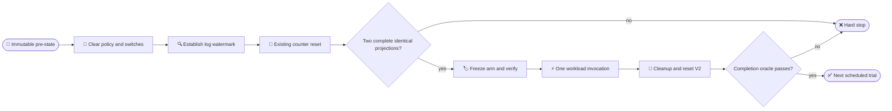

# CDAC RQ4 prospective performance protocol V2

_From-zero two-boot evaluation on the retained S10 artifact; frozen before any warm-up or scientific invocation._

---

## 📋 Scope and prospective authority

V2 is a new campaign. V1 remains permanently `PARTIAL`; no V1 measured row,
engineering probe, RQ2 row, partial diagnostic, latency, contrast, interval,
or denominator enters this campaign. The protocol hash, freeze timestamp, and
the later first-scientific-execution timestamp establish prospective ordering.
`SCIENTIFIC_TRIALS_BEFORE_PROTOCOL_FREEZE=0` is mandatory.

The retained S10 artifact, route, caller, sender, controller/parser boundary,
workload, object-selection procedure, capability oracle, and timing boundary
are inherited read-only from the verified RQ2 and A/B/C preflight packages.
The only methodological change from V1 is the closure-validated reset and
carry-over accounting recorded in `RESET_AND_CARRY_OVER_ORACLE_V2.md`.

## 🎯 Scientific questions and arms

| Arm | Frozen meaning | Required machine oracle |
| --- | --- | --- |
| A | same-artifact CDAC-inactive baseline | registered bypass; no CDAC decision path; successful usable capability |
| B | CDAC active, no reviewed rule | active decision path; empty policy; `matched=0`, `rule_src=default`; usable capability |
| C | CDAC active, one registered nonmatching rule lookup | one legal decoy rule; active path; nonmatching lookup; usable capability |
| D | reviewed target denial | exact target rule; direct `errno=-13`; app-visible failure; no capability; balanced denied accounting |

Arm A is never called a native or unmodified Android baseline. Arm D reports
only absolute application-visible denial-response latency; no D-minus-arm
contrast or denial overhead is computed.

## 🔄 Trial boundary and reset state machine

Before every invocation, V2 records an immutable pre-state; clears policy and
switches; establishes a monotonic/log watermark; issues the existing debugfs
counter reset; and retains two complete post-reset snapshots whose frozen
trial-sensitive projection is identical. Broad module/control-plane counters
remain in raw snapshots and are interpreted by pre-state baseline/delta.
Aliases are retained but never counted as independent events. Only then is the
next arm configured and machine-verified. After invocation, the same cleanup
oracle is required; any failed conjunct retains the triggering row and stops.

## 📦 Retained artifact and route

Each boot rechecks build fingerprint, kernel identifier, `SELinux=Enforcing`,
`framework.jar`, kernel module, sender, controller, parser, caller APK/package
and version, endpoint presence/registration/enabled state, service/op/route,
workload and object identities, retained image hashes, clock/unit, and the
V2 reset procedure/oracle hashes. A mismatch before invocation contributes zero
scientific rows and halts execution. No source, binary, image, sender,
controller, parser, route, or workload is rebuilt or replaced.

## 🧪 Denominator, blocking, and warm-up

Two independent boots are required. Boot is a repeated/reporting factor, never
a treatment. Each boot has 50 A/B/C blocks, with five trials per arm and a
seeded random permutation of A/B/C within every block. D follows the frozen
50-block × five-trial stage. Thus A, B, C, and D each contribute 250 rows per
boot and 500 rows across boots; the total scientific denominator is 2,000.

Each boot has 20 warm-ups for A, B, and C (60 rows), separately recorded and
excluded from every denominator, estimator, stopping decision, and adaptation.

Frozen V2 seeds are `SCHEDULE_SEED_V2=13089570349927168327` and
`BOOTSTRAP_SEED_V2=1679099201949269052`. Boot-2 order is derived before any
execution and cannot depend on boot-1 observations.

## ⏱️ Timing and outcome oracle

The primary latency is the retained APK's `elapsedRealtimeNanos()` interval
around `ContentResolver.openFileDescriptor()` through descriptor close or the
registered exception. The unit is nanoseconds. Controller ISO and host
monotonic timestamps, kernel markers, raw app output, and all state snapshots
are retained; kernel timestamps are diagnostic only.

Once the invocation sentinel/broadcast begins, the row is permanent in the raw
denominator regardless of latency, failure, timeout, or oracle outcome. Only
the preregistered pre-invocation exclusions are allowed. No trim, winsorization,
outlier removal, replacement, or rerun is permitted.

## 📊 Registered estimator

For every complete A/B/C block, take the median of the five latency values for
each arm and form `Delta_BA = median(B) - median(A)` and
`Delta_CB = median(C) - median(B)`. Report pooled and boot-specific medians
with 95% percentile intervals from 10,000 bootstrap replicates. Bootstrap is
stratified by boot and resamples whole blocks using the frozen V2 bootstrap
seed; individual trials are never independent bootstrap units. `Delta_CA`, arm
mean/median/P95/P99, and boot-specific distributions are secondary only.

For D report N, pooled and per-boot mean/P50/P95/P99 of **absolute
denial-response latency**. Do not compute or name denial overhead, native
comparison, or kernel-only lookup cost.

## 🛑 Stopping and eligibility

Execution may stop only for artifact/protocol/hash mismatch, failed V2 reset or
carry-over completion oracle, verified state contamination, parser corruption,
unresolvable CVD/ADB failure, or safety/integrity risk. Result direction,
interval position, significance, heavy tails, and denial magnitude cannot stop
or adapt execution. PASS means prospective ordering, registered raw-row
retention, exact registered analysis, and archive verification; it does not
mean low or negligible latency.

## 🚫 Prohibited claims

Do not claim native Android overhead, unmodified Android overhead, negligible
or zero overhead, speedup, denial overhead, kernel-only lookup cost,
Android-wide/DP performance, Pixel 8/AOSP15, old Batch4B numbers, V1 partial
diagnostics, approximately 35 microseconds at N=4096, or generalization beyond
this retained route/artifact.
